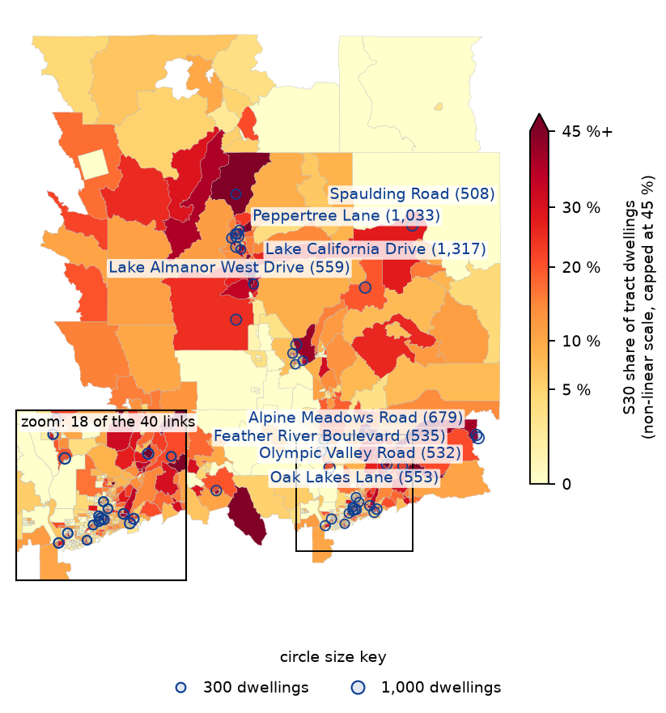
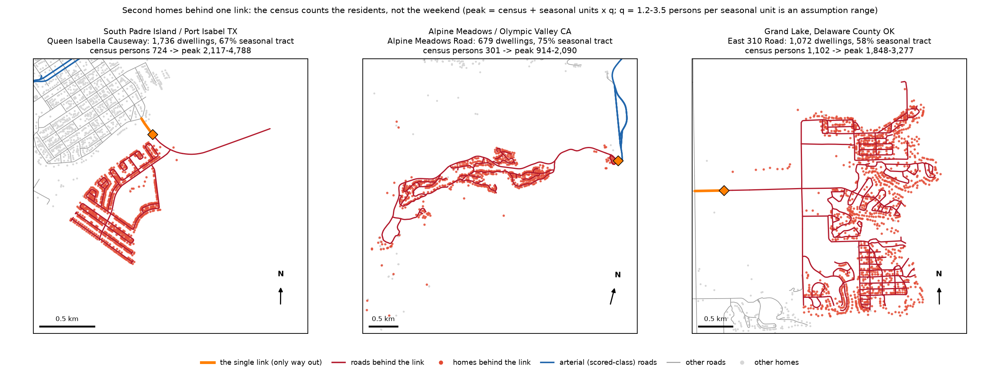
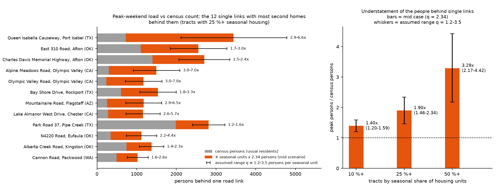
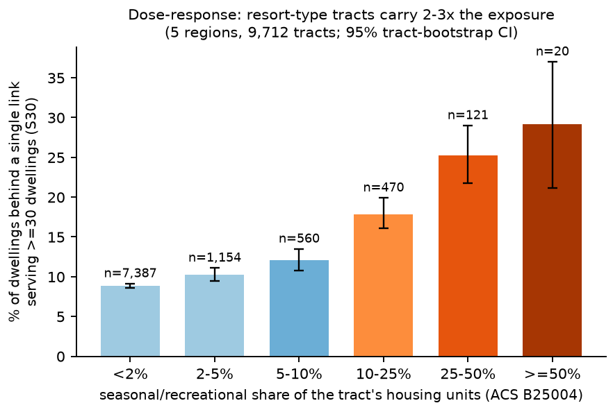
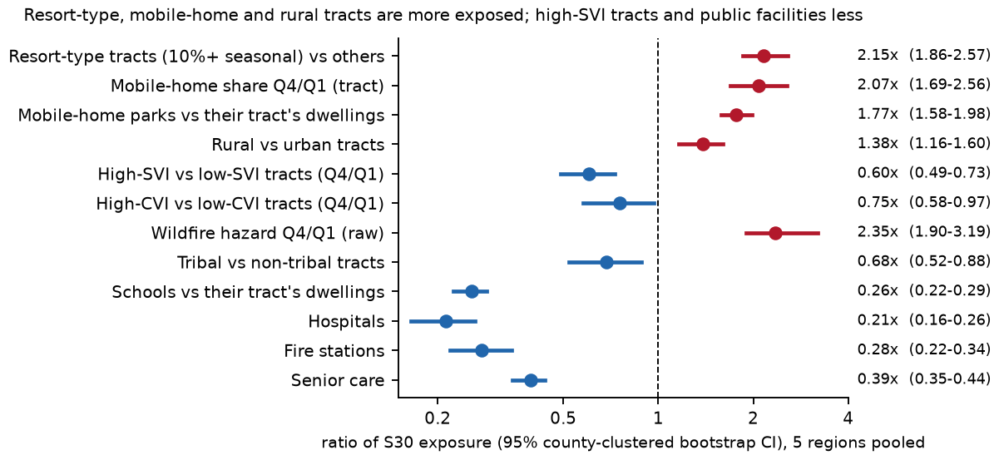
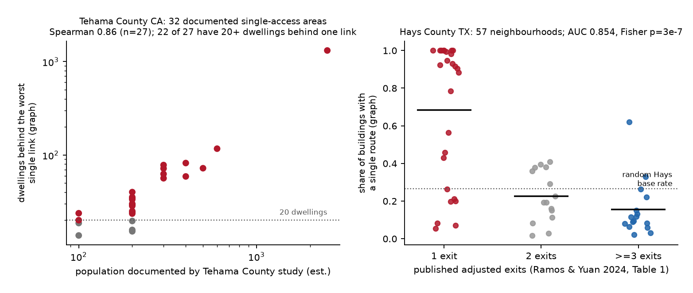
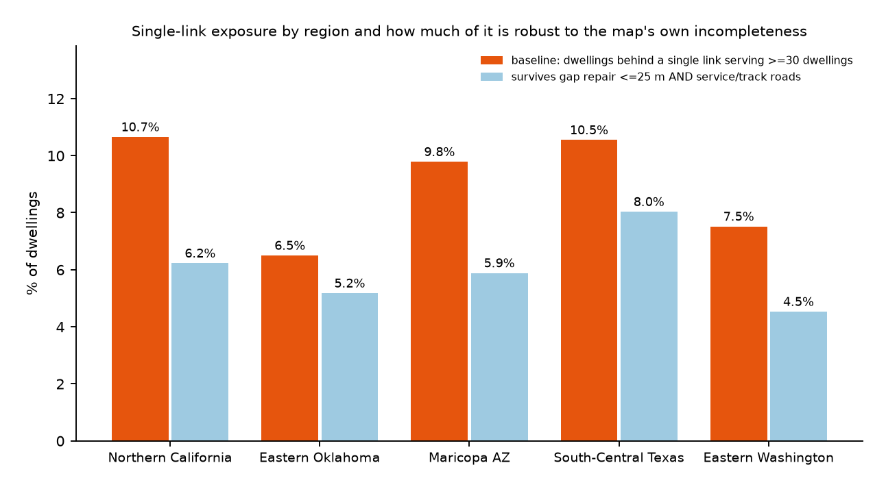

# One way out: 3.76 M people depend on a single local road link the coverage score never measures. Mobile-home parks and second-home communities are most exposed; SVI points the other way.

*Best Bias Discovery entry by Zindi user mk1981 (solo). Replaces our first form response (15 Oct); same findings and numbers. Target-free analysis of Overture 2026-08-19.0. Leaderboard submissions: xJSdnKdQ; final selections iZXAFjgS and 8VL4MpNN.*

## 1. The pattern the scorecard does not surface

**Finding 1: one way out.** The scorecard credits arterial kilometres, not whether homes have a second route upstream. Of 17.0 M dwellings (39.9 M people) across five regions, **9.9 % (1.68 M dwellings, 3.76 M people) sit behind one road link that serves at least 30 dwellings ("S30")**, the model-code benchmark (IFC D107.1). Exposure is 1.77x for mapped mobile-home parks and 2.15x in seasonal communities; high-SVI tracts are less exposed (0.60x). County evacuation studies confirm the classification; gap repair removes 3.9 %. Overall, 21.3 % reach the arterial network by a single route; 806 k behind links serving 100+, 277 k 300+. S30 by region: N. California 10.7 %, E. Oklahoma 6.5 %, Maricopa 9.8 %, S-C Texas 10.5 %, E. Washington 7.5 %.

*Fig. 1. Northern California: shading = share of dwellings behind a single link (30+ dwellings; non-linear scale); circles = 40 largest links (area ~ square root of dwellings); inset zooms on the densest cluster.*

**Who.** Mapped mobile-home parks sit behind single links 1.77x as often as all dwellings in the same tracts (23.5 % vs 13.3 %; 1.58-1.98). Top vs bottom mobile-home-share quartile: 2.07x (1.69-2.56). Tracts with 10 %+ seasonal/recreational housing (ACS B25004; 612 of 9,712) carry **2.15x** the S30 exposure of others (19.9 % vs 9.2 %; 95 % CI 1.86-2.57, resampling 325 counties), rising from 8.9 % (<2 % seasonal) to 29 % (50 %+). High-SVI tracts are *less* exposed (top vs bottom quartile 0.60x, 0.49-0.73): SVI points the wrong way. Also exposed: 69.5 k car-less households, 47.6 k with no transit stop within 800 m. Walden Rd, Lake Conroe TX: 4,291 dwellings.

**Consequence.** Link failure cuts evacuation and outside relief for car-less households; seasonal census undercounts also understate clearance and shelter loads.

**Why the scorecard cannot see it.** Its road term compares Overture length with TIGER on motorway, trunk, primary and secondary roads only. By construction of the egress search, the 10,951 km of single-egress segments lie upstream, outside those classes (81 % are residential), yet 97.9 % of S30 dwellings are in tracts with roads of those classes. We measure route redundancy, not how much road a tract has; no stratum describes housing type.

**Finding 2: census counts understate the people behind the link.** Second homes have no census residents but fill on peak weekends. Behind single links, tracts with 25 %+ seasonal housing hold **1.10 census persons per dwelling (0.97-1.24) vs 2.34 (2.28-2.39)** where seasonal housing is <2 % (ratio 0.47, 0.41-0.53; 185 counties). Adding each link's seasonal units times q persons per seasonal unit (low 1.2, mid 2.34, high 3.5; an assumption), the 176 such links carry **47.9 k census persons but 70 k / 91 k / 112 k at peak (1.5x / 1.9x / 2.3x; mid-case CI 1.73-2.10, 43 counties)**; 2.2-4.4x where seasonal housing is 50 %+. Across the 3,931 single-link clusters (100+ dwellings, census residents) the gap is only 3-8 %: a resort-community effect. Allocation is not driving it: the 18 links serving a quarter or more of their tract's housing give 1.4x / 1.8x / 2.2x.

*Note on q.* q = occupied share x persons per occupied unit; the package has no occupancy data. Mammoth Lakes CA plans with 4.0 persons per occupied second-home or visitor unit, found second homes occupied 49 % of the year, and estimated 34,265 persons on an average winter Saturday against 7,259 residents (Eagle Lodge Draft EIR, 2006). A 1987 Southwest Florida hurricane evacuation study assumes July-November occupancy of 51-64 % for condominiums and 43-75 % for mobile homes (RPC). Our range is 4.0 persons at 30 / 59 / 88 % occupancy.

## 2. Evidence

**Named places** (single links serving 100+ dwellings; peak = census + seasonal units x q, low-high):

|Single link (road, place)|Tract|Dwellings|Census persons|Peak persons|
|---|---|---|---|---|
|Walden Rd, Lake Conroe TX|48339694305|4,291|8,264|8,943-10,244|
|Cranes Mill Rd, Canyon Lake TX|48091310608|2,840|5,620|5,884-6,392|
|Queen Isabella Causeway, South Padre TX|48061012305|1,736|724|2,117-4,788|
|E 310 Rd, Grand Lake OK|40041375804|1,072|1,102|1,848-3,277|
|Alpine Meadows Rd, Olympic Valley CA|06061022014|679|301|914-2,090|
|Mountainaire Rd, Flagstaff AZ|04005001500|538|253|725-1,630|

*Fig. 2. Resort clusters: red = homes and roads whose only way out is the orange link; blue = arterials.*

*Fig. 3. Census vs peak persons behind the 12 links with most second homes (whiskers: assumed q 1.2-3.5); multiplier by stratum.*

**Comparisons and controls.** The seasonal contrast holds in every region (1.6x N. California to 4.8x E. Oklahoma, all CIs above 1), within rural-only (1.84x, 1.62-2.06) and urban-only (2.17x, 1.89-2.47) tracts, at 5, 10 and 20 % thresholds, under alternative weights, and with controls plus county fixed effects (+3.3 points of S30 per +10 points of seasonal share, 1.95-4.68; +3.9, 2.6-5.3 with road density).

*Fig. 4. S30 exposure by seasonal share of housing.*

*Fig. 5. Effect sizes (S30 ratios), county-clustered bootstrap 95 % CIs, five regions pooled.*

**Validation against independent documentation.** Tehama County CA evacuation study, a public record adopted by resolution (Table 2 facts transcribed only): 27 of 32 documented single-access areas matched; documented population vs graph load Spearman 0.86 (p = 8e-9); 22 of 27 have 20+ dwellings behind one link vs 30.7 % of named roads in the same towns. Hays County TX (Ramos & Yuan 2024, 57 neighbourhoods): AUC 0.854, Fisher p = 3e-7; one-exit areas flagged 17/26 vs multi-exit 1/31.

*Fig. 6. Tehama County CA (left), Hays County TX (right).*

**How much is the map's own fault?** Closing digitising gaps up to 25 m removes only 3.9 % of S30 dwellings (3-8 % by region), admitting service and track roads 25 %, either 28 %: 72 % survives both. Repairs never improve agreement with Hays or Tehama (100 m+ erases documented single-exit flags), so 3.9 % bounds the gap-induced part. Nor are the trapped described worse: egress links are named more often (96.8 % vs 88.7 % for same-class roads in the tract), their recent-edit share is no lower, and footprints are ML-derived equally often (44.7 % vs 43.1 %). Phantom roads could add false second routes, understating S30. The gap is the arterial-length coverage definition, not generally missing map content.

*Fig. 7. Exposure by region and the part robust to gap repair and service roads.*

**Method.** Drivable Overture roads (no service/track), cut at connectors, form the graph; sinks are arterial classes and tract-boundary exits; single links are bridges. Buildings of 35 m2+ snap within 500 m to the nearest road; ACS B25001 housing units and 2020 Census persons (strata table) are spread equally over a tract's candidate buildings (alternative weights give S30 of 7.3-13.1 %). Seasonal units behind a link = its dwellings x tract seasonal share. Intervals: bootstrap over tracts and 325 counties.

## 3. Who is affected and why it matters

**Evacuation.** Walden Rd, Cranes Mill Rd and Old Conroe Rd (TX) put 4,291, 2,840 and 2,299 dwellings behind one link; Paradise had 927 occupied housing units per egress lane in the 2018 Camp Fire (NIST TN 2252), and the model fire code (IFC D107.1) benchmarks single-access developments at 30 dwellings, subject to adoption and exceptions. At Queen Isabella Causeway (724 census persons) and Alpine Meadows Rd (301) the assumed mid-case peak load is about 5x the census count (3,441 and 1,497; low case 2,117 and 914). Census-based clearance and shelter estimates understate who needs that road.

**Dispatch.** For 98.3 % of S30 dwellings no mapped fire or EMS station lies on their side, so outside responders cross the evacuation link. This also applies to five of the six places above and 500 of the 527 clusters of 300+ dwellings; dwellings over 10 minutes (free-flow) from a mapped station are 1.65x as likely (1.54-1.77) to sit behind an S30 link (189-230 k dwellings; not in Oklahoma).

**Relief.** 69.5 k car-less households sit behind S30 links, 47.6 k with no transit stop within 800 m.

**What to change.** Add a single-link-egress metric to the scorecard and housing type (seasonal and mobile-home share) as a stratum; per-link lists for all regions are in `tables/<region>_drv_A_links.csv`.

## 4. How this differs from other entries
Road density (35157/35081) measures road quantity; reference-based mobile-home and colonia gaps (34995/34744), address coverage (34962) and fire-station gaps (34925/35030/34847/34993) measure completeness. We test redundancy where parks and homes are mapped. A listed low-water crossing on a single link (35033) is one case we rank: no hazard list, five regions, dwelling/person weights. The seasonal and mobile-home effects survive a road-density control (rho with S30 -0.33). None of the public forum entries we read mentions seasonal housing or maps single-link egress for all dwellings (NOVELTY.md).

## 5. Limitations
Assumptions: equal unit allocation, tract-share seasonality, q; ACS five-year margins; no traffic, capacity, gate or ford data; free-flow driving; observational.

## 6. Reproduction and sources
Python 3.12, DuckDB 1.5.4 (E. Washington about 1 minute); seed 20261014. Commands/sha256: REPRODUCE.md; code/tables: https://github.com/mkorayemai-web/zindi-bias-bounty-single-egress; sources: SOURCES.md.
Second platform: rebuilt from empty work folders on Linux aarch64, all 193 offline ledger checks of printed numbers pass at their printed precision (the other 9 quote external documents); x86 untested.

## Appendix A. Pinhole leads (unverified)
For 190 of 3,933 single-link clusters (100+ dwellings) most homes would gain a second route if an unconnected stretch up to 25 m were closed (512 at up to 50 m), e.g. Mountain Shadows Boulevard, Redding (399 dwellings, 4.3 m); lists in PINHOLES.md. These are unverified leads; repairs of 100 m+ erase documented single-exit areas in Hays and Tehama (CALIBRATION.md).
